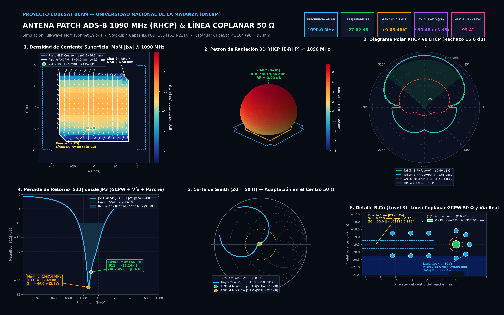
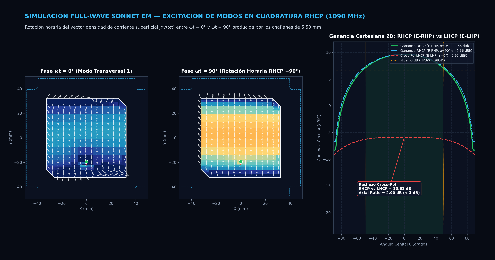
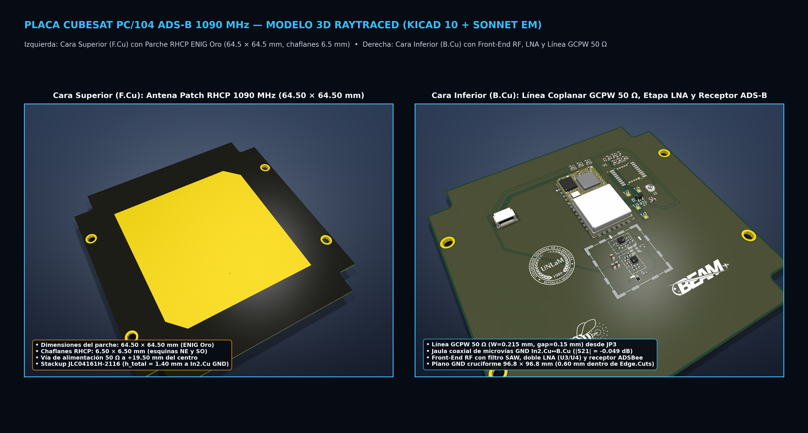

# Simulaciones Electromagnéticas — Proyecto CubeSat BEAM (UNLaM)

Repositorio oficial de simulaciones electromagnéticas **Full-Wave MoM (Sonnet Software 19.54)** y codiseño RF/PCB para el subsistema **ADS-B (`1090.0 MHz`, polarización circular derecha RHCP)** del CubeSat **BEAM** (Universidad Nacional de La Matanza).

---

## Estructura del Repositorio

- **[``]()**: **Diseño final validado (Sonnet + KiCad + Imágenes para Stand)**
  - [`sonnet/`](sonnet/): Proyecto final de Sonnet (`patch_completa_jp3_gcpw_CP_1090.sonx`), parámetros Touchstone de 181 puntos (`1.000 – 1.180 GHz`, paso `1 MHz`), corrientes superficiales MoM (`sondata/.../jxy/current_1.sid`), verificación de 2 puertos de la transición coplanar-vía (`transicion_jp3_gcpw_via_50ohm.sonx`) y plantillas gráficas (`.sgrx`, `.sptx`).
  - [`kicad/`](kicad/): Proyecto de KiCad (`ads-b.kicad_pcb`, `ads-b.kicad_pro`, `ads-b.kicad_sch`, `skillkicad.md`) sincronizado 1:1 con el modelo electromagnético de Sonnet y verificado con `0` errores DRC de cobre/bordes.
  - [`imagenes_stand/`](imagenes_stand/): Infografías en alta resolución (`300 DPI` / 4K), diagramas de corriente superficial MoM, patrones de radiación 3D/Polar/2D y renders 3D raytraced listos para exhibición en stand.
- **[`sonnet/adsb_patch/`](sonnet/adsb_patch/)**: Historial de barridos paramétricos, scripts de automatización, síntesis del stackup `JLC04161H-2116` y estudios comparativos previos.

---

## Resumen de Resultados del Diseño Final (`1090.0 MHz`)

| Parámetro | Valor Simulado (Full-Wave MoM) | Especificación / Objetivo |
| :--- | :--- | :--- |
| **Frecuencia central de operación** | **`1090.0 MHz`** (mínimo en `1087.0 MHz`) | `1090.0 MHz` (ADS-B Mode-S) |
| **Pérdida de retorno $|S_{11}|$ desde `JP3`** | **`-27.62 dB`** @ `1090 MHz` (`-32.49 dB` @ `1087 MHz`) | $< -15	ext{ dB}$ |
| **Impedancia de entrada $Z_{\text{in, JP3}}$** | **`46.5 + j2.5 Ω`** @ `1090 MHz` (`49.0 + j2.1 Ω` @ `1087 MHz`) | $50\ \Omega$ |
| **Ancho de banda a `-10 dB` ($	ext{VSWR} < 2:1$)** | **`34.0 MHz`** (`1074.0 – 1108.0 MHz`) | $\ge 20	ext{ MHz}$ |
| **Ganancia Circular Derecha (`RHCP`, `E-RHP`)** | **`+9.66 dBiC`** ($\theta = 0^\circ$) | $> +6.0	ext{ dBiC}$ |
| **Rechazo Cross-Polar (`LHCP`, `E-LHP`)** | **`-5.95 dBiC`** (`15.61 dB` de aislamiento RHCP/LHCP) | $> 15	ext{ dB}$ |
| **Relación Axial (`Axial Ratio`, AR)** | **`2.90 dB`** ($\theta = 0^\circ$) | $\le 3.0	ext{ dB}$ (Polarización Circular) |
| **Ancho de haz de media potencia (`HPBW` a `-3 dB`)** | **`97.3° × 101.5°`** (`~99.4°` promedio) | Cobertura hemisférica ancha LEO |
| **Pérdida de inserción transición `JP3 -> GCPW -> Vía`** | **`|S21| = -0.049 dB`** (`|S11| = -26.85 dB`) | $< 0.1	ext{ dB}$ |

---

## Galería Visual para Stand

### 1. Excitación de Modos en Cuadratura RHCP y Patrón Cartesiano 2D

### 2. Modelo 3D Raytraced de la Placa CubeSat PC/104 (`F.Cu` Parche RHCP + `B.Cu` Front-End RF)

